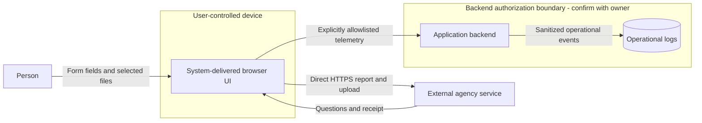

# Methodology

## Minimum review inputs

Capture system identity and mission; ownership and authorization roles; FIPS 199
confidentiality/integrity/availability impact rationale; information types;
approved baseline/profile and tailoring; agency organization-defined parameters;
template version; operating environments; boundary and external services;
inventory; users/roles; identity and privileged access; data flows and retention;
control implementation; inherited/shared responsibilities; assessment evidence;
continuous monitoring; incident/contingency procedures; and POA&M/risk decisions.
This is an intake map, not a universal agency submission checklist. Obtain the
actual agency requirements before declaring package completeness.

For each control part, answer who does what, where, how, when, and with what
evidence. Include responsible team/component, status, planned work, and applicable
parameters. A policy title or matching heading is not an implementation narrative.
Assessment may combine examination, interviews, and testing; automation alone
cannot establish training completion, agreement applicability, or owner approval.

## External-service record

Use a row per service/environment: owner, hostname/endpoints, transport and trust
boundary, purpose, request/response fields, sensitive categories, credentials,
cookies/tokens, storage locations, TTL/deletion behavior, logging/telemetry,
subprocessors, authoritative agreement/CRM, and observed-versus-claimed scope.
Distinguish browser → provider from backend → provider. Include transmission
before final submission, uploads, cleanup failures, callbacks, errors, and exports.

## Mermaid conventions

Use Markdown Mermaid for iterative authoring. Nodes represent actual execution/storage
locations; solid arrows are evidenced transfers, dashed arrows are unverified or
planned and must be labelled. Give each diagram an environment, source revision,
observation date, and evidence references. Do not draw a provider inside the
authorization boundary just because its hostname ends in the system's domain.

This is a generic illustration, not an approved system boundary diagram.
For identity, add a sequence diagram distinguishing browser redirects, code
exchange, userinfo, session creation, token storage, expiry, and logout. Mark
simulated issuers and synthetic identities explicitly.

## Common review pitfalls

- Migrated controls preserve source assertions, including ambiguous statuses;
  external component stubs do not establish inherited controls.
- Browser-only agency reporting still handles PII and file data. Preparation
  may transmit data before final Submit; removing a report reference does not
  establish deletion of the uploaded bytes.
- Agency-owned sign-in and a prototype OIDC client are distinct flows.
  Prototype code is not proof of production identity integration.
- Profile/catalog resolution, implementation adequacy, and artifact rendering
  are separate checks. Preserve source requirements during reconciliation.

## Reviewer deliverable

Produce a concise requirements/evidence matrix, service and data inventory,
diagrams, prioritized findings with proof limits, decision register, and
versioned verification transcript. Summarize counts by assessed/unassessed and
evidence kind; avoid a single compliance percentage that hides missing evidence.
